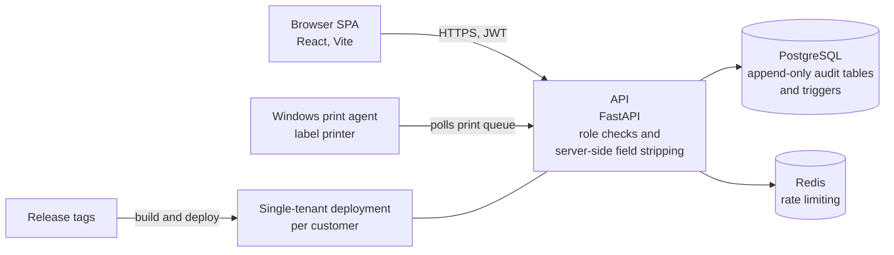
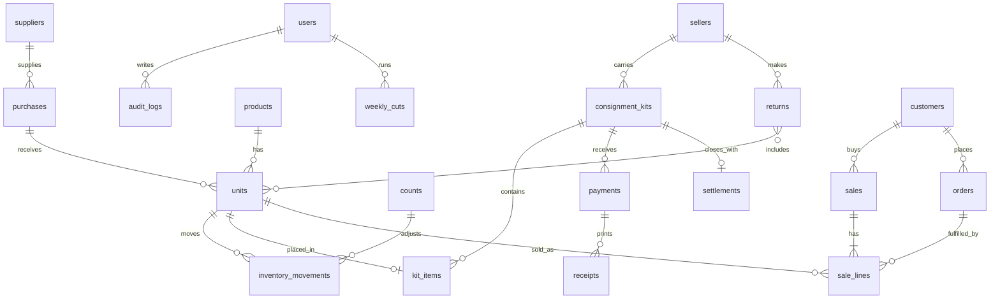

# Nedi

Nedi is a multi-tenant inventory, sales and consignment management system for jewelry retailers. It was built for a real jewelry retail business and is offered to other jewelry sellers.

**Please read this first.**

- The source code is private. This repository documents the system: what it does, how it is shaped, and how it was built and tested.
- The code was written by AI coding agents (Claude Code and OpenAI Codex) under the author's direction and review.
- The author made the product and architecture decisions and merged every change.
- Every number below is labelled "from the private production project" and comes from a measurement taken on 2026-11-18.

## Who uses it

| Role | What they do |
| --- | --- |
| Owner / super admin | Creates accounts, changes roles and per-account permissions, sees everything including costs and margins. |
| Admin | Approves over-limit consignment requests, unlocks the weekly cut, settles accounts, sees costs and reports. |
| Manager | Delivers and settles consignment kits for their own sellers, runs the weekly cut, records payments. Never sees cost or margin. |
| Inventory staff | Receives stock, prints labels, runs counts. Does not see declared totals or cost. |
| Front desk | Direct sales, orders with deposits, customer registry. |

Sellers who carry consignment kits have records in the system but no application screens.

## Stack (from the manifests of the private production project)

- Backend: Python 3.12, FastAPI 0.141.1, Pydantic 2.13.4, SQLAlchemy 2.1+, Alembic 1.20+, PostgreSQL 16, Redis.
- Auth: PyJWT, bcrypt, TOTP multi-factor authentication.
- Frontend: React 18.3, Vite 8, React Router 7, Recharts 3, Spanish-language UI (strings centralized in one catalog).
- Tests: pytest 8 with xdist, schemathesis, vitest 5, Playwright 1.62, playwright-bdd 9.2.

## Features

Only features that have been released to production are listed.

### Inventory and labels
- Inventory intake per piece and per quantity.
- Barcode labels with a print queue and a Windows print agent.
- Inventory counts by delivery sessions.
- Suppliers and purchases.
- Products and photos.
- Pricing formulas.
- Defects and write-offs.
- Spreadsheet inventory importer.

### Consignment
- Consignment kits: plans, assembly, delivery, terms, over-limit approvals.
- Seller records and applications.
- Returns with second-person verification.
- Weekly cut.

### Sales
- Direct sales.
- Orders with deposits.
- Client registry.
- Sales summary.
- Dashboards.

### Payments and settlement
- Payments, cash receipts and settlements.

### Administration and security
- Login with JWT, TOTP multi-factor authentication and session renewal.
- Role-based field stripping on the server.
- Per-account permissions.
- Users and audit logs.
- In-app notifications.

### Multi-tenancy
- Multi-tenant branding and deployment profiles (consignment, retail, inventory-only).
- Single-tenant deployments per customer, built from release tags.
- Home page with a module selector.

## Architecture

The API is the only trust boundary. Cost, margin and global earnings fields are removed in the serializers for roles that must not see them, so hiding them in the UI is never the only control. The database refuses updates and deletes on audit and movement tables with triggers.

## Data model

Generic English table names; the production schema uses its own naming.

## Testing approach

Layers, all run by a single gate script before any change is merged:

1. Backend unit and API tests (pytest, parallel with xdist) plus a serial group and a separate database-integrity suite that checks triggers, constraints and append-only tables against a real database.
2. Contract fuzzing of the API (schemathesis).
3. Frontend unit tests (vitest).
4. Browser end-to-end tests (Playwright), plus BDD scenarios (playwright-bdd).
5. Shell test harnesses for the guard scripts that protect the repository and the agents' workflow.

Numbers from the private production project, latest full gate run on 2026-11-18 (exit 0):

- Backend: 8,061 passed (parallel), 211 (serial), 766 (database-integrity suite).
- Frontend: 3,821 unit tests in 194 files.
- Browser end-to-end: 445 passed, 0 failed, 9 skipped (454 collected).
- Shell harnesses: command guard 561 cases, role guard 339, seat launcher 189, pre-push 114.
- Static counts: 275 backend test files, 80 Playwright spec files, 9 BDD feature files with 23 scenarios, 28 shell test harnesses.

Other figures from the private production project:

- API: 44 router registrations, 335 route handlers.
- Database: 92 tables, 51 Alembic migrations, 14 append-only audit tables, 99 CREATE TRIGGER statements.
- Delivery: 3,766 commits on the integration branch over 4 months with commits (first 2026-08-16, last 2026-11-18); 552 pull requests opened, 515 merged; 23 release tags (v1.0.0 on 2026-09-19 to v1.14.5 on 2026-11-10); 27 architecture decision records; 607 numbered owner decisions, each timestamped with the owner's words verbatim.

## How it was built

All code was written by AI coding agents under the author's direction and review. 2,150 of the 3,766 commits (about 57%) carry a Claude co-author trailer and 62 carry a Codex trailer (from the private production project).

A seat model keeps the work organized. Two orchestration sessions plan and challenge work orders but never write code. Implementation goes to pinned worker agents (Claude workers and a Codex seat) in isolated git worktrees, each on its own branch with a list of allowed paths. Every pull request is reviewed by the opposite seat (a Claude change by Codex, a Codex change by a Claude reviewer), a single gate script runs the tests, and only the author merges. Product rules live in a decision log where each ruling records the owner's words verbatim.

The setup has 17 Claude subagent definitions (each pinned to a model), 17 slash commands and 17 generated Codex role contracts. Guard scripts refuse unsafe actions. Two secret-leak incidents motivated them: an agent sourced an environment file and echoed a token, and a subagent read an environment file with a file tool and printed credentials into a transcript. Both led to hard rules and enforcing hooks.

The reusable part of this workflow is published separately: [agentic-delivery-kit](../agentic-delivery-kit).

## Not built

To stay honest about scope: production orders, kanban, a model catalog, a costing module, email notifications, password self-service and credit sales are not part of the released system.

## Screenshots

To be captured from a demo that uses fictional data only.

1. `screenshots/01-home.png`: the home page with the module selector.
2. `screenshots/02-inventory-table.png`: the inventory table.
3. `screenshots/03-product-intake.png`: a product intake form.
4. `screenshots/04-direct-sale.png`: a direct sale.
5. `screenshots/05-sales-summary.png`: the sales summary.

## License

Text and diagrams in this repository are licensed under CC BY 4.0, see `LICENSE.md`. The licence does not cover the private source code of the system.
